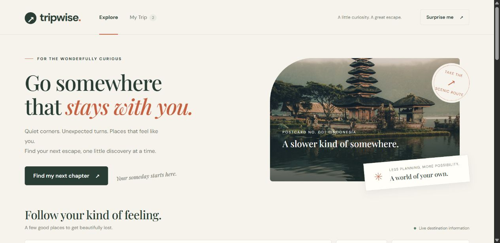
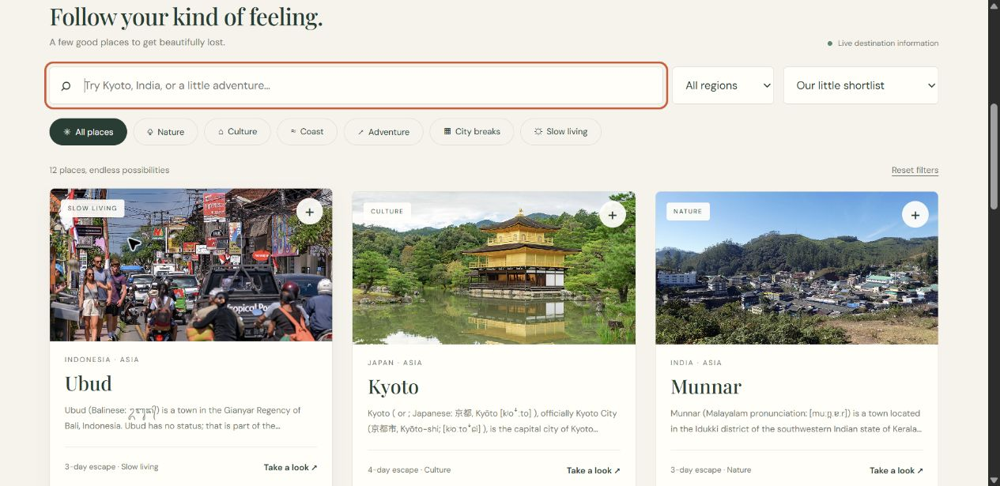
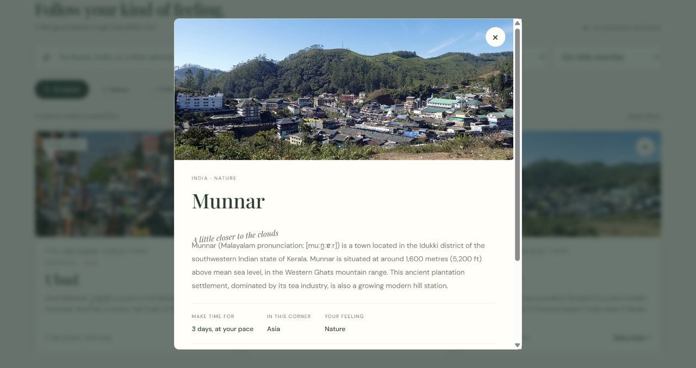
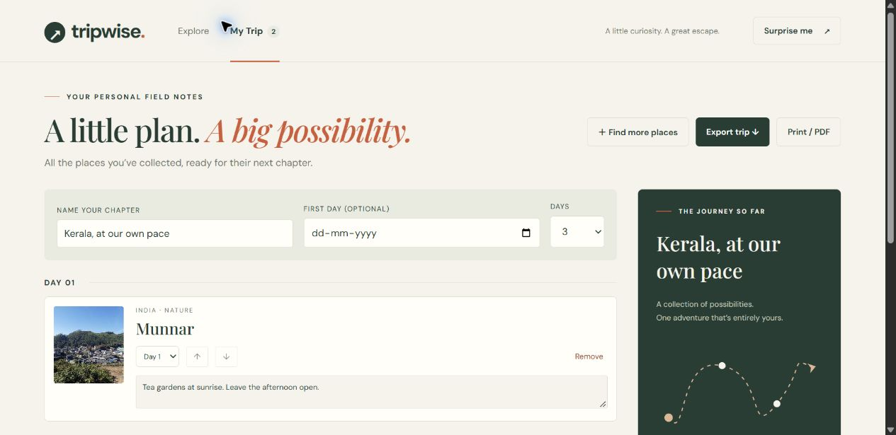

# TripWise — Field Notes

**A little curiosity. A great escape.**

TripWise turns travel inspiration into a personal plan. Discover a curated shortlist of destinations with live place information, read the story behind each place, and collect your favorites into a day-by-day itinerary that survives refresh.



**Track:** Frontend Development · **Stack:** HTML, CSS, JavaScript · **Product backend:** None · **Persistence:** Browser localStorage

**Live website:** [tripwise-fieldnotes.vercel.app](https://tripwise-fieldnotes.vercel.app)

**Source code:** [Joshan2007/tripwise-fieldnotes](https://github.com/Joshan2007/tripwise-fieldnotes)

## The experience

1. **Explore** — browse destination postcards, search by place or country, combine travel-style and region filters, and choose a useful sort order.
2. **Look closer** — open a destination to read its description, see its location and suggested visit length, view its source and map, and collect it.
3. **Make it yours** — name your trip, choose dates and days, move places between days, reorder stops, and leave personal notes.
4. **Keep the plan** — return after refresh, export your itinerary as a text file, or use the browser print dialog to save a trip PDF.

## Run locally

Requires Node.js 20 or newer. No package installation, API key, database, or backend service is required.

```sh
npm start
```

Open http://127.0.0.1:4173. Serve the app over HTTP; do not double-click index.html because browser module loading requires a server.

```sh
npm run check
node tests/check.mjs
node tests/motion.mjs
```

## Mandatory frontend features

- **Destination exploration:** 12 place records enriched at runtime through the real Wikipedia MediaWiki Action API. Cards display photos, destination names, country, category and extracted text.
- **Search:** case-insensitive matching across destination name, country, travel style and editorial tagline.
- **Filters:** combine continent and six travel styles. Filters work together with search.
- **Sorting:** editorial order, name A-Z, name Z-A, and suggested visit length.
- **Details:** accessible native dialog with live description, location, travel style, suggested duration, source article, photo credit/license link, map link when coordinates exist, and collect action.
- **Itinerary:** add, view and remove destinations; duplicate prevention; browser localStorage persistence across refresh.
- **Responsive experience:** desktop three-column grid, mobile two-column grid and one column on narrow screens, stacked trip board, and mobile details dialog.
- **Feedback:** loading skeletons; explicit network/API errors with retry; no-results and empty-itinerary states; cached results clearly identified during a service outage; unavailable-image fallback; storage-failure feedback.

## Distinctive features

Travel-journal visual direction with paper, forest green and terracotta colors; serif typography; postcard photography; circular travel stamp; ticket motif; day assignments; trip naming and optional start date; notes; keyboard-accessible reorder buttons; surprise destination; itinerary text export; print/save as PDF layout; and a decorative route sketch clearly identified as non-geographic.

## Technology and structure

Semantic HTML, CSS Grid/Flexbox, vanilla JavaScript ES modules, browser localStorage, and a zero-dependency Node static server for development. The deployable frontend consists only of `dist/`.

- `dist/index.html`: shell, navigation, dialog and footer.
- `dist/styles.css`: layout, design system, responsive and print styles.
- `dist/data.js`: curated destination identifiers and editorial metadata.
- `dist/app.js`: API integration, view rendering, combined filters, itinerary and persistence.
- `dist/motion.js` and `dist/motion.css`: progressive animation layer and interaction transitions.
- `server.mjs`: local static file server; it does not implement product APIs or store itinerary data.
- `tests/check.mjs`: deterministic network/storage and filtering checks against the production code.
- `screenshots/`: screenshots captured from the browser for the submission PDF.

## API details

Endpoint: `https://en.wikipedia.org/w/api.php`

An anonymous GET request uses `action=query`, `origin=*`, `redirects=1`, and `prop=extracts|pageimages|coordinates` with the curated Wikipedia titles. `exintro=1` and `explaintext=1` return introductory plain text; `pithumbsize=900` requests a photo thumbnail. Returned `query.pages` records are matched to the editorial shortlist, following redirects. A second batch request uses `prop=imageinfo` to retrieve photographer and license metadata for the returned images. No private API keys or credentials are used. Filtering and sorting run locally without additional requests.

Destination titles are curated in data.js, while descriptions, photos and coordinates are loaded live. Search operates over the returned shortlist; this is not a worldwide arbitrary-city search. Visit lengths and categories are editorial suggestions, not API-provided availability or booking data.

A 15-second timeout and HTTP/response validation handle failure. A previously successful response is cached in localStorage. If a later fetch fails, a warning explicitly says that saved information is being shown. On a first-load failure the interface shows an error with retry rather than fake destination data.

Documentation: https://www.mediawiki.org/wiki/API:Main_page and https://www.mediawiki.org/wiki/API:Cross-site_requests

## Persistence and privacy

`tripwise.fieldnotes.v1` stores trip name, optional date, day count, destination identifiers, assigned days, and personal notes. `tripwise.places.v1` caches public place information. Data remains in this browser and is not synchronized between devices. Private browsing/storage restrictions may prevent saving; export is available in that case. Rendering escapes text, checks external URLs, validates saved destination IDs and clamps day values.

## Credits

Destination text: Wikipedia contributors, CC BY-SA; each destination links to its full article. Each destination photograph displays its photographer, license, source link, and a notice that it has been cropped. These values come from Wikimedia image metadata. Images whose attribution cannot be retrieved are omitted while the destination remains usable. Hero photograph: Bali temple, served by Unsplash (`photo-1537996194471-e657df975ab4`), under the [Unsplash License](https://unsplash.com/license). Fonts: DM Sans and Playfair Display through Google Fonts, with system fallbacks.

## Verification

Verified in Chrome: live API returned 12 destinations; combined India + Asia + A-Z returns Alleppey, Hampi, Leh, Munnar; no-match search shows the empty state; add from details/card; notes, name and day assignment persist after refresh; native modal; reorder controls; responsive 390px layout with no horizontal overflow. Automated checks cover failed network, cached fallback, malformed responses, invalid/corrupt storage, duplicates and escaping. On the Vercel production site, an unauthenticated request returned HTTP 200, all 12 destinations and photographer/license credits loaded, and an itinerary item remained after refresh. Browser error logs were empty during this check.

## Deployment and submission

The target host is **Vercel**. Import `Joshan2007/tripwise-fieldnotes`, select framework **Other**, and keep the repository root as the project root. The included `vercel.json` runs `npm run check` and publishes `dist/`. No API keys, database configuration or environment variables are required. Verify the final production URL in a signed-out browser before submitting it to the judges.

## Screenshots





The 12-page PDF uses a plain white A4 document layout with simple headings and page numbers. It includes the desktop views and key states, plus five actual phone screenshots covering destination details, My Trip, the journey summary, Android print preview, and Explore. The earlier simulated mobile screenshots have been removed from the PDF.

## Scope and tradeoffs

### Motion direction

Animations follow the quiet pace of the travel-journal design: staggered text entrances, a postcard photo reveal, settling stamp and ticket, scroll-triggered destination reveals, button and image hover feedback, a collection-count bounce, dialog entrance, and smooth itinerary reordering. A short dotted-route animation adds a small travel detail to the trip summary.

Motion uses native browser APIs with no animation library. IntersectionObserver runs reveals when content enters the viewport; transforms and opacity carry the entrance animations. Reveals run once per rendered element. System reduced-motion preferences disable CSS and JavaScript motion, cancel active animations when changed, and make discovery scrolling immediate. Print output keeps reveal content visible. Hover effects apply only to devices with hover support.

Design reference: [A Short Journey on Awwwards](https://www.awwwards.com/sites/a-short-journey), adapted to TripWise's own postcard and journal visual language. Accessibility reference: [W3C SCR40](https://www.w3.org/WAI/WCAG21/Techniques/client-side-script/SCR40).

### Product boundaries

- A focused list of 12 destinations makes discovery predictable and keeps the initial API request small. The interface clearly searches this shortlist rather than claiming to search every destination worldwide.
- The app calls the external API directly from the browser, which fits the frontend track. A database or custom product backend is not required.
- The route illustration is decorative. Real coordinates link out to OpenStreetMap; the app does not claim to calculate an optimized route or travel times.
- Itinerary data is local to the current browser. There is no account system or cross-device synchronization.
- Live place information, third-party images and web fonts depend on external services. The app includes service failure, cached data and image fallback behavior, with system fonts available when font loading fails.
- Suggested visit lengths and categories are editorial metadata. Booking, weather and price feeds are outside this implementation's scope.
